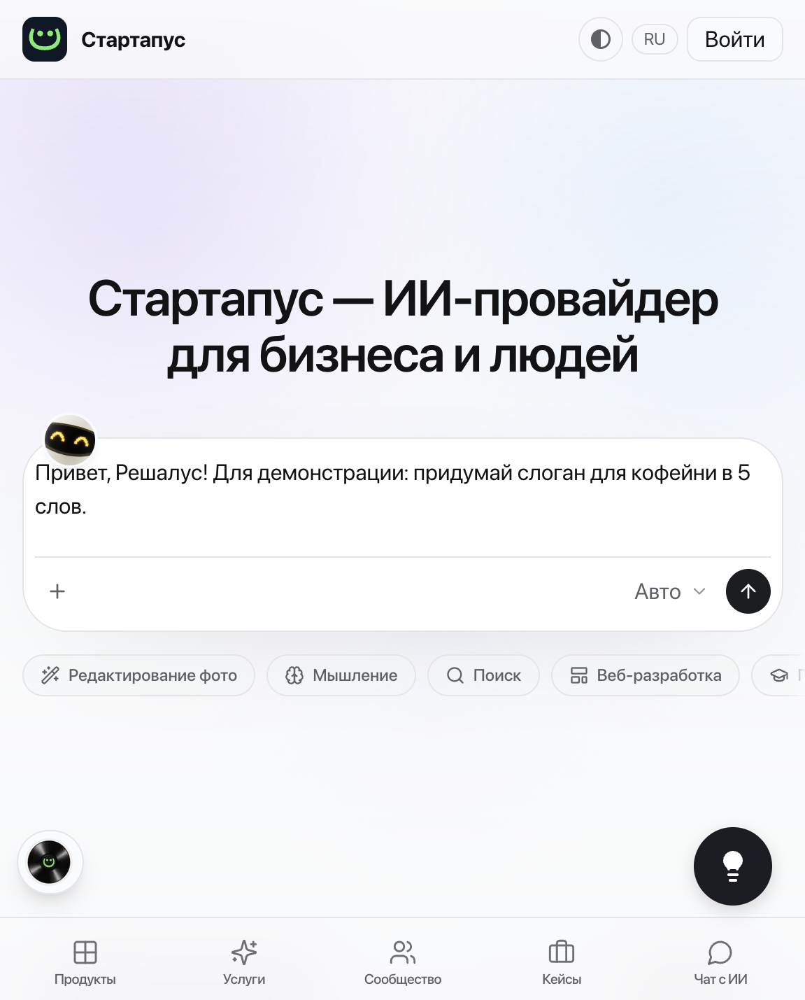
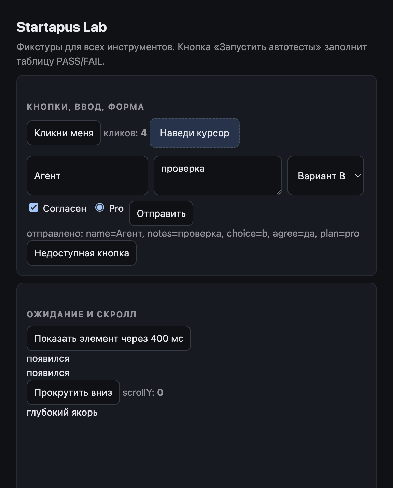
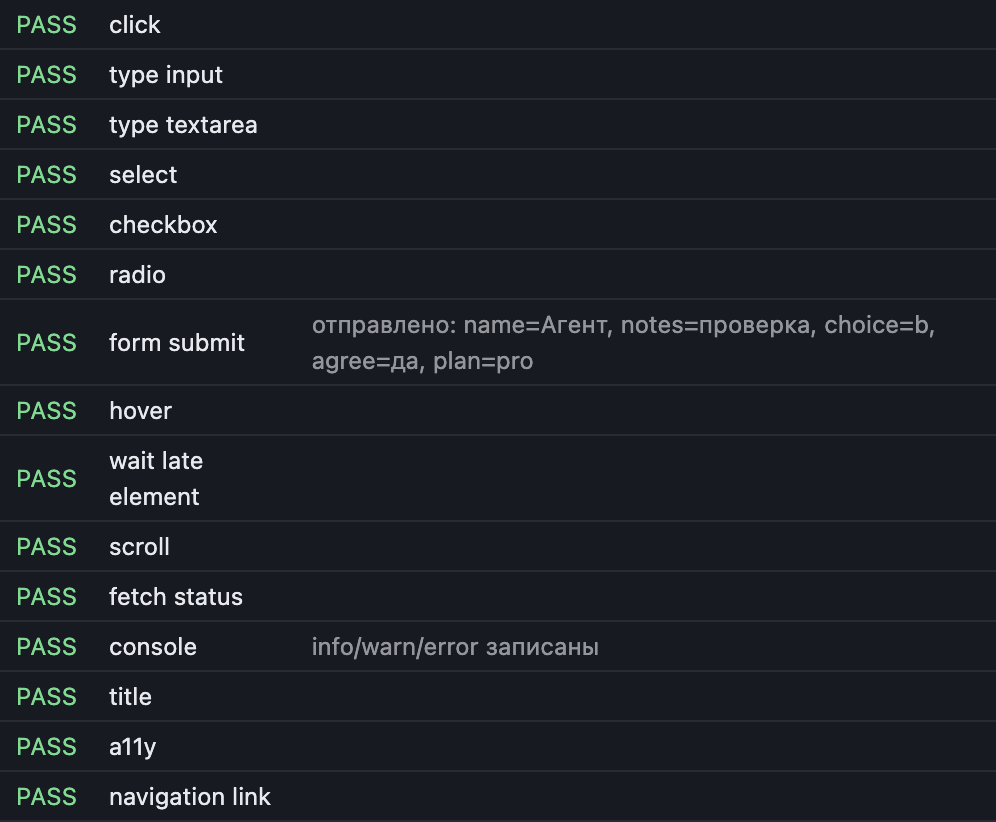

# Startapus Browser

Браузер в правой панели DSH: настоящий Electron `<webview>` (не iframe), произвольные
сайты, toolbar и DOM-пикер элемента, который отправляет выбранный элемент агенту в
композер как чип `ЭлементN`.

## Быстрый старт

1. Плагин в профиле `~/.dsh/profiles/desktop/cordis.patch.yml`; штатный браузер ядра отключён
   (`- id: ui-sidebar-browser / disabled: true`) — это освобождает `⌘T`.
2. Запустить DSH, открыть правый сайдбар.
3. **Нажать `⌘T`** (Ctrl+T вне macOS) — вкладку активирует само ядро, панель монтируется
   видимой, движок создаёт гостя и открывает `https://startapus.com`.
4. Дальше агент управляет страницей инструментами; человек при необходимости забирает
   управление кнопкой в панели.

Почему первый раз вкладку открывает человек: у плагина нет API активации вкладки
(см. `docs/kernel-request.md`). Из состояния «ни одной вкладки» агент вкладку создать
может, но ядро её не показывает — поэтому канонический вход именно `⌘T`.

## Горячие клавиши и адресная строка

| Действие | Как |
|---|---|
| Открыть браузер | `⌘T` (`startapus-browser.new` в каталоге ярлыков) |
| Ввод адреса | строка адреса, `Enter`; поддерживаются `example.com`, `http(s)://…` |
| Переключение вкладок | клик по ярлыку в полосе (ядро); агент — `ui_focus_tab { tabId }` |
| Пикер элемента | `⌘⇧P` или кнопка-прицел в панели (`requestPick`) |
| Экспорт задач | `ui_export { crops }` → zip в `~/.dsh/` |
| Управление агентом | баннер «Агент управляет страницей» / «Забрать управление» |

## Диагностика

- `~/.dsh/startapus-host.log` — `apply:start`, `tools:registered`, `verify:done/error`,
  `act:done`, `select:done`, `crop:saved`, `lease:acquire/release`, `guest:lost`,
  `guest:crashed`, `attach:timeout`, `dom:tabs`.
- `/startapus-browser/health` — `buildRev`/`clientRev`/`revMatch`, `panels`, `sessionsCount`,
  `urlHost`, `panelMounts`, `counters {acquires, releases, recoveries, crashes, navigations,
  loadErrors, attachFailures}`, `lastLoadError`, `lastNavAttempt`, `shortcutState`.
- `npm run live` — сверка живого процесса (FRESH, transport, selftest, утечка lease,
  шторм восстановлений, ресинхрон сборок).
- `npm run soak` (или `npm run soak:short`) — наблюдение за инвариантами жизни вкладки.
- `scripts/dsh-cookie-doctor.mjs` — накопление `dsh-auth-*` cookie (причина падений DSH).

## Что умеет

Стартовая страница по умолчанию — `https://startapus.com`.

- вкладка **Startapus Browser** в правом сайдбаре (`sidebar.right.pane.tab`);
- произвольные `http(s)`-адреса в `<webview>` (без ограничений `X-Frame-Options`/CSP,
  которые накладывает iframe);
- toolbar на иконках `react-icons`: назад, вперёд, обновить, **копировать адрес**,
  **открыть в браузере по умолчанию**, выбор элемента;
- кнопка **⌖** — пикер: подсветка элемента под курсором, селектор в подсказке,
  `Esc` — отмена;
- автоматическая вставка чипа `ЭлементN` в композер активной сессии и
  модель-ориентированная сериализация при отправке;
- строка статуса: `резервация → dom-ready → загрузка → загружено`, ошибки и
  падения guest-а видны без DevTools.

## Как это устроено

1. **Guest с резервацией.** Главное окно DSH создаётся с `webviewTag: true`, но ядро
   подключает только «зарезервированный» `<webview>`. Панель берёт резервацию из
   прелоада:

   ```ts
   const { lease, partition } = await window.dshDesktop.browser.acquire('startapus-browser')
   const el = document.createElement('webview')
   el.setAttribute('name', lease)
   el.setAttribute('partition', partition)
   el.setAttribute('allowpopups', '')
   el.setAttribute('src', `about:blank#${lease}`)
   el.dataset.sidebarBrowserFrame = 'webview'
   ```

   Ядро проверяет `src` (`about:blank#<lease>`), `partition` и одноразовость lease;
   при несовпадении — молча `preventDefault()`. После `dom-ready` панель вызывает
   `loadURL(url)`.

2. **Пикер без preload.** Перед attach ядро стирает `preferences` гостя, поэтому
   собственный preload невозможен. Пикер внедряется через
   `webview.executeJavaScript(PICKER_SCRIPT)`; результат паркуется в
   `window.__startapusPick`, а панель опрашивает его простым значением (объект
   ошибки через IPC не клонируется — иначе `An object could not be cloned`).

3. **Чипы и сериализация.** Чип вставляется через
   `conversation.input.for(binding.ctx).insertReference(...)`. При отправке ядро
   ищет владельца чипа по имени источника и вызывает его `codec.serialize`,
   поэтому источник регистрируется как `@`-триггер:

   ```ts
   ctx.inject(['inputTriggers'], (inner) => {
     ctx.effect(() => inner.inputTriggers.registerSource(elementSource()))
   })
   ```

   Без этой регистрации отправка падает с
   `slash: no serializer for reference source "startapus-element"`.

4. **Одноразовый lease.** Если за 4 с не пришёл `dom-ready`, панель освобождает
   резервацию и берёт новую (одна повторная попытка) вместо вечного пустого экрана.

## Установка

```bash
cd startapus-browser
npm install --no-save --no-package-lock esbuild@0.25.12
node build.mjs
```

В `~/.dsh/profiles/desktop/package.json`:

```json
"dependencies": { "startapus-browser": "link:/abs/path/to/startapus-browser" },
"dsh": { "profile": { "bundles": ["…", "startapus-browser"] } }
```

```bash
cd ~/.dsh/profiles/desktop && pnpm install
# затем перезапустить DSH
```

## Использование

1. Открой вкладку **Startapus** в правой панели, введи адрес.
2. Нажми **⌖**, наведи на элемент, кликни.
3. В поле ввода агента появится чип `Элемент1`, а внизу панели — короткая строка
   `вставлено в композер: Элемент1` (полный портрет уходит агенту, а не в панель).
4. Отправь сообщение: модель получит структурированное описание элемента.

## Диагностика

Строка внизу панели:

| Сообщение | Значение |
|---|---|
| `запрос резервации guest…` | вызывается `browser.acquire` |
| `резервация ok · partition dsh-sidebar-browser-…` | lease выдан |
| `guest подключён, ожидание dom-ready` | элемент вставлен в DOM |
| `dom-ready · навигация…` | гость готов, идёт первая загрузка |
| `загружено · <url>` | страница отрисована |
| `guest не подключился · ядро отклонило attach` | lease не совпал/просрочен |
| `acquire упал: …` | текст ошибки из main-процесса |
| `нет моста window.dshDesktop.browser` | панель вне главного фрейма |
| `элемент выбран · <причина>` | чип не вставлен (нет сессии/композера) |

## Инструменты агента

Агенту видно **21 инструмент**: 35 исходных свёрнуты в консолидированные (`ctx.tools.register`, каждый с обязательным
`output { schema, render }`). Старые имена по умолчанию остаются тонкими устаревшими алиасами (`legacyToolNames: 'aliases'`; `false` — убрать, `true` — вернуть 35 оригиналов целиком);
свёрнутые инструменты делегируют оригиналам, поэтому лимиты, гейты и ошибки те же. Покрытие тестами — `docs/tool-audit.md`.

| Инструмент | Что делает | Заменяет |
|---|---|---|
| `ui_tab { action }` | list / new / close / focus / activate вкладок | `ui_tabs`, `ui_new_tab`, `ui_close_tab`, `ui_focus_tab`, `ui_activate_tab` |
| `ui_status { guest? }` | состояние панели; с `guest:true` ещё и диагностика гостя | `ui_guest_state` |
| `ui_open { url \| history }` | переход по адресу или back / forward / reload | `ui_navigate` |
| `ui_pick { mode }` | выбор элемента или области человеком | `ui_pick_area` |
| `ui_evidence { area? }` | портрет выбранного элемента или области | `ui_area` |
| `task_create { …\| items }` | задача или пакет до 20 | `task_batch` |
| `task_list { id? }` | список или одна задача | `task_get` |
| `task_update { id, state \| owner }` | смена состояния или «взять в работу» | `task_claim` |
| `ui_inspect` | замер стилей и геометрии элемента | `ui_measure` |

Остальные инструменты без изменений: `ui_viewport` (zoom, ширина, пресеты, `colorScheme`), `ui_read_page`, `ui_find`,
`ui_page_text`, `ui_console`, `ui_network`, `ui_screenshot` (`wait`, `diff`), `ui_select`, `ui_act` (click/type/scroll/press с
комбинациями/hover/select/check/drag/click_at, `ref`, пакет до 10), `ui_wait`, `ui_js`, `ui_verify` (**только он ставит
`verified`**; критерии `computed`, `box`, `text`, `exists`, `visible`, `contrast`, `no-hscroll`, `in-viewport`).
Убраны из видимого набора как малоиспользуемые: `ui_template`, `ui_export` (доступны через `legacyToolNames`).

## Канал host ↔ renderer

- `GET  /startapus-browser/health` — диагностика транспорта;
- `GET  /startapus-browser/selftest` — автотест гейтов и компаратора;
- `POST /startapus-browser/client/poll` — панель забирает команду (`open`/`pick`/`reload`/`verify`);
- `POST /startapus-browser/client/event` — stage, url, evidence, консоль, результат verify.

Панель опрашивает канал каждые 2.5 с, авторизуясь через `window.dsh.getAuthToken()`; без heartbeat 15 с любой `ui_*` отдаёт `E_NO_TRANSPORT`.

## Проверки

```bash
npm run selftest     # офлайн: гейты, компаратор, verify-движок, soak, area, page-скрипты — 67 проверок
npm run live         # живой процесс: сверка capabilities, transport, selftest на госте
```

`npm run live` печатает, какая сборка реально запущена: отпечаток `buildRev` из `/health`
сравнивается с хешем исходников, поэтому «устаревшая сборка» видна сразу, без догадок.

Пошаговый чек-лист живой приёмки (AC-1, AC-2, снимок, управление агентом, гейты):
[`docs/live-acceptance.md`](docs/live-acceptance.md).

## Ограничения

- Куки и история живут в partition `startapus-browser`, не общие со штатным
  браузером DSH.
- Страница переживает переключение вкладок: гость живёт в пуле и переподключается к панели.
- Preload недоступен (стирается ядром), поэтому только `executeJavaScript`.
- Скачивания и всплывающие окна ограничены политикой ядра.

## Структура

```
src/index.ts                 host-плагин (регистрация)
src/client/index.tsx         вкладка + регистрация источника элементов
src/client/panel.tsx         <webview>, toolbar, статус, пикер
src/client/picker-source.ts  внедряемый скрипт пикера
src/client/element-refs.ts   чипы, кодек, вставка в композер
build.mjs                    esbuild: host ESM + client CJS в __ModuleLoader__
```

## Проверки и релиз

```bash
npm run gate        # сборка + SCRIPT/RULES/ENGINE/IMPORTS/TOOLS + selftest — обязательный гейт
npm run gate:live   # то же + сверка с запущенным процессом (FRESH, transport, живой selftest)
node scripts/build-rev.mjs   # отпечаток сборки
```

Релиз: версия в `package.json` = тег (`v0.24.0`), `CHANGELOG.md` — по фичам,
матрица `startapus-browser-compliance.md` обновляется тем же коммитом.

## Установка из маркета DSH

Центрального стора у DSH нет: маркет — это JSON-индекс, который пользователь добавляет сам.

1. В DSH: **Plugins → More → Experimental plugins → «Custom plugin markets»** — включить.
2. **Discover → Add source** → вставить
   `https://cdn.jsdelivr.net/gh/Startupus-Team/DSH_start_browser@master/market-index.json`
3. Установить **Startapus Browser**, перезапустить DSH, открыть правый сайдбар и нажать `⌘T`.

Подробности и регламент релиза — [`docs/publishing.md`](docs/publishing.md). Сборка индекса:
`node scripts/market-pack.mjs --git-source` (артефакты в `dist/` и корневой `market-index.json`).

## Install (copyable)

Marketplace index (Discover source):

```
https://cdn.jsdelivr.net/gh/Startupus-Team/DSH_start_browser@master/market-index.json
```

CLI install of the bundle (npm channel, when published):

```bash
dsh plugin --profile web add startapus-browser
# or from this repository, pinned:
dsh plugin --profile web add git+https://github.com/Startupus-Team/DSH_start_browser.git
```

Manual (developer) install: add to `~/.dsh/profiles/desktop/package.json` dependencies
`"startapus-browser": "link:/path/to/startapus-browser"` and to `dsh.profile.bundles`.

## Screenshots





## Permissions and risks

- **Arbitrary web content**: the tab renders any http(s) site inside an Electron `<webview>`;
  the site runs with its own origin privileges, but the browser can send page-derived data
  (text, DOM, screenshots) to the agent — treat it as untrusted input.
- **Host code in-process**: the host half registers tools and HTTP routes inside DSH; install
  only from a source you trust (this repository).
- **Local files**: review tasks (`~/.dsh/startapus-tasks.json`), screenshots
  (`~/.dsh/startapus-crops/`), diagnostics (`~/.dsh/startapus-host.log`). Nothing is uploaded
  by the plugin itself; `ui_export` writes a zip locally.
- **Network**: the plugin opens the sites you point it at, plus loopback only when a human
  types the address (agent navigation to private hosts is blocked).
- **Kernel APIs**: relies on DSH desktop webview leases and the sidebar tab API; a DSH update
  may require a matching plugin release (`engines.dsh`).
